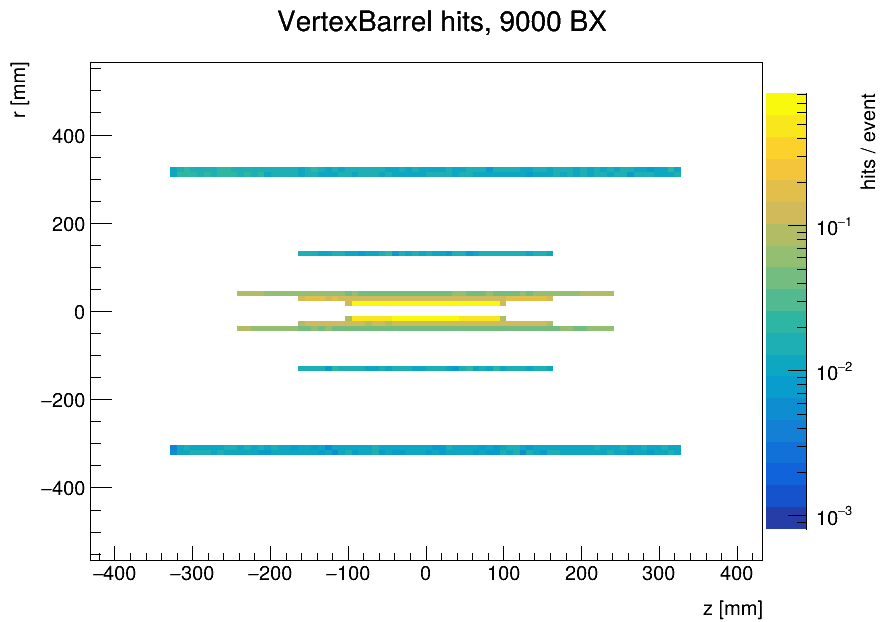
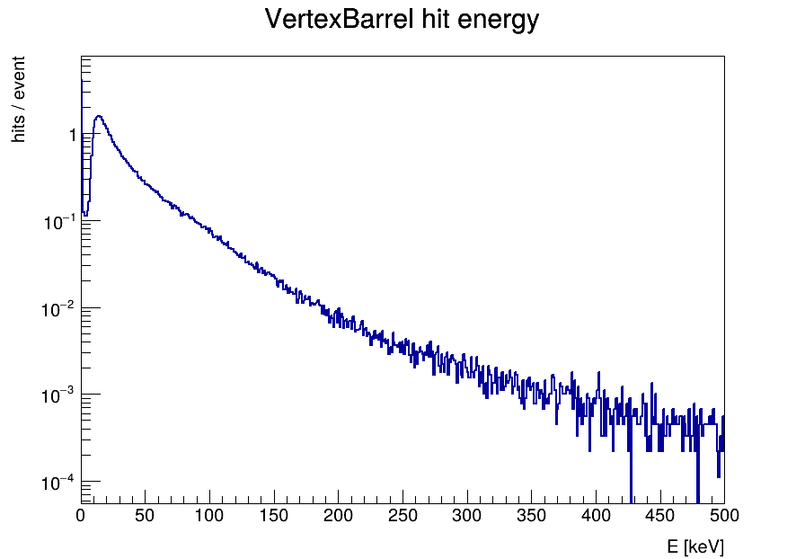
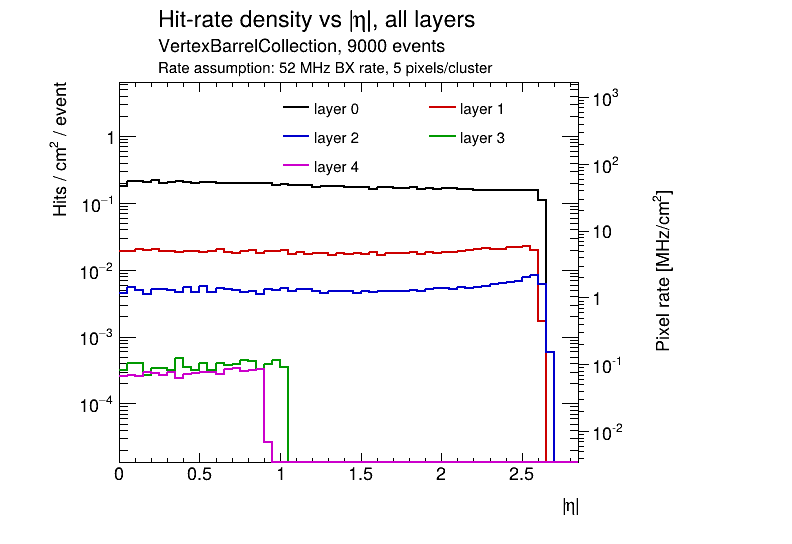

# Beam induced background studies

Code and scripts developed to run beam induced background (BIB) studies,
following a _detector agnostic_ approach. 

## Quick Start

For recent practices/files, see also the [FCC SW MDI page](https://hep-fcc.github.io/FCCSW/mdi/)

```sh
# starting in an AFS/EOS folder with cvmfs+eos access, and subscription to
git clone git@github.com:HEP-FCC/bib-studies.git
cd bib-studies
source setup.sh

# create a working directory where to run the code
mkdir run
cd  run

drawhits.py -s VertexBarrel -e 10 -D 0
#will produce a root file with histograms
```

## What can I do with this repo?

A few examples, all on the VertexBarrel of ALLEGRO with 9000 simulated bunch crossings of incoherent pair creation (IPC).
The scripts are documented in the [plotting docs](./plotting/README.md), the output is a ROOT file with folders (`maps`, `global`, `per_layer`, ...)
that can be browsed with [JSROOT](https://root.cern/js/), plus optional pdf plots (`-m` maps, `-p` histograms).

**Hit maps and distributions** of a sub-detector, normalised per event:
```sh
drawhits.py -i <sim_output.root> -s VertexBarrel -d $BIB_STUDIES/detectors_dicts/ALLEGRO_o1_v03_DetectorDimensions.json -m -p
```



**Hit-rate density** vs pseudorapidity of every layer, with a second axis that scales it by an example rate (52 MHz, 5 pixels/cluster), saved as a canvas in the same file:



Other things that `drawhits.py` fills: occupancy per layer and per module, pile-up (`--integration_time`), the time since the previous hit in the same module (`--bc_window`),
hit timing and time of flight corrected timing, and the MC particles that created the hits.

**All the sub-detectors at once**, in parallel, with a log per sub-detector and a summary of the status (and, optionally, of the bandwidth):
```sh
plot_all_subdetectors.py -i <sim_output.root> -e 100 -j 4 --hits2high --skip_layers_for DCH_v2 -p -m
```

**Bandwidth, hit rate and occupancy estimates** from the `drawhits.py` output, with a JSON of assumptions (hit size, pixel size, safety factors):
```sh
hits2highLevelEstimations.py -i <drawhits_output.root> -d $BIB_STUDIES/detectors_dicts/ALLEGRO_o1_v03_DetectorDimensions.json -a $BIB_STUDIES/detectors_dicts/ALLEGRO_o1_v03_assumptions.json
```

**Generator-level inspection** of the BIB particles before any simulation (kinematics and production vertices of all the MC particles):
```sh
drawMCparticles.py -i <guinea-pig_edm4hep.root> --mcCollection Pairs -e 100 --sample pairs
```

**Simulating the background** through a detector with HTCondor, one job per background file, see the [simulation docs](./simulation/README.md):
```sh
submit_bkg.py -i <bkg_files_folder> -t <tag> -c $K4GEO/FCCee/ALLEGRO/compact/ALLEGRO_o1_v03/ALLEGRO_o1_v03.xml -s <abs/path/to/steering_file.py> --mcCollection Pairs -n 10
```

## Setup script

The `setup.sh` script will setup this repository paths and 
the latest *stable* release of the `key4hep` software stack:

```sh
source setup.sh
# or, for latest nightly:
source setup.sh -n
# for a given release:
source setup.sh 2025-05-29
# or for a given (dated) nightly, which does not change, so it is reproducible:
source setup.sh -n 2026-10-02
# list the available dated nightlies:
source setup.sh -n -l
```

A nightly given as a date is a *spack* nightly (the `--spack` option of the key4hep setup is added automatically),
while `-n` alone or with a weekday (`-n Tue`) uses the default nightly stack of key4hep (LCG on AlmaLinux 9),
which is overwritten every week. `--spack` and `--lcg` can also be given explicitly, see `source setup.sh -h`.
Note that the spack nightlies are no longer built upstream (the last one is 2026-10-20) and the `--spack` option of key4hep will soon fail.

## Repo structure

This repo contains four principal folders:
-  `plotting` for executable scripts concerning plots
-  `simulation` with utility scripts and recipes for running simulations, and a list of relevant gen files.
-  `python` where shared code is stored together with detector specific implementations of key functions used by the scripts.
-  `detectors_dicts` storing detectors related dictionaries.

The two folders with the executable scripts contain dedicated `READMEs` with more complete info:
- [Simulation docs](./simulation/README.md)
- [Plotting docs](./plotting/README.md)

## Recommended workflow

- get bib files (eg produced by Jan, Giulia, A. Ciarma..): edm4hep `.root` files, or the older hepevt/pairs formats
    - set vertices to 0, if running on `.pairs` samples before 2026 [see here](https://github.com/HEP-FCC/bib-studies/tree/main/simulation#set_vertex_000py)
- using the `submit_bkg.py` script, submit condor jobs to simulate the bib particles through your detector of choice (eg ALLEGRO), which gives root files
- use the drawhits/plot_all_subdetectors scripts to generate occupancy and other plots
- optional: use the hits2highLevelEstimations.py script to extract more numbers from the occupancy plots

